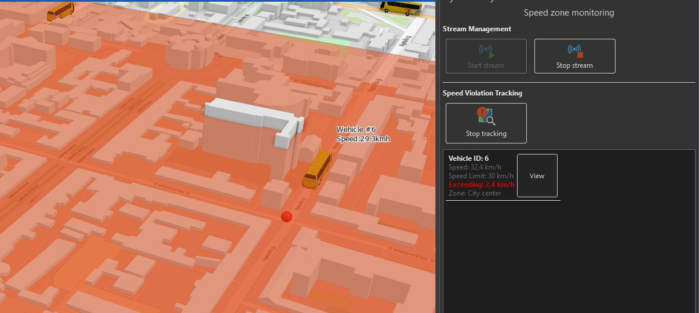

# DynamicLayerSample

Overview
--------
This ArcGIS Pro add-in demonstrates real-time streaming and speed-zone violation tracking using a `StreamLayer` (public transport) and a polygon `FeatureLayer` (`Speed zones`). The dockpane provides simple controls to start/stop the stream, enable/disable violation tracking, and inspect current speed violations.

Key features
------------
- Start and stop streaming of the `Public transport` stream layer.
- Detect vehicles that are inside `Speed zones` where the vehicle speed exceeds the zone `SpeedLimit`.
- Track one violation record per vehicle per zone.
- Persist violations to a `Speed Violations` layer (if present) and display them in the dockpane.
- Select a violation to pan the map to the vehicle and show details.

Prerequisites
-------------
- ArcGIS Pro with the SDK installed
- Project containing layers named exactly:
  - `Public transport` (StreamLayer)
  - `Speed zones` (FeatureLayer with fields `ZoneName` (string) and `SpeedLimit` (integer))

Usage
-----
1. Open the map or scene containing the `Public transport` and `Speed zones` layers.
2. Open the `Dynamic Layer` dockpane (Add-in menu) to start the sample UI.
3. Use `Start stream` / `Stop stream` to control the streaming connection.
4. Click `Track speed violations` to begin monitoring vehicles inside `Speed zones`.
5. Violations appear in the list. Click `View` to pan to the vehicle and inspect the recorded violation.

Implementation notes
--------------------
- The add-in searches for vehicles by `VehicleID` (not ObjectID) because stream layers may reuse or replace object IDs.
- Violations are tracked in memory and optionally written to a `Speed Violations` feature layer if present in the map.
- The dockpane UI is implemented in `Controls\Dockpane1.xaml` and the main logic lives in `Controls\Dockpane1ViewModel.cs`.
- The data model for violations is in `Models\SpeedViolationAlert.cs`.

Files
-----
- `Controls\Dockpane1.xaml` - Dockpane UI
- `Controls\Dockpane1ViewModel.cs` - Dockpane view model and logic
- `Controls\SelectAlertCommand.cs` - ICommand implementation to select alerts
- `Models\SpeedViolationAlert.cs` - Violation data model

Credits
-------
Sample adapted for an ESRI Developer Summit Europe 2026 presentation.
